# Báo cáo thực hành số 6: Trích chọn đặc trưng ảnh và ứng dụng trong các mô hình học máy (KNN, SVM, Random Forest)
Môn học: Xử lý ảnh và thị giác robot (RBE3015)  
Sinh viên thực hiện: Nguyễn Quang Tuân – 23020767  
Giảng viên phụ trách: PGS.TS. Hoàng Văn Xiêm | CN. Bùi Đình Đăng  

---

## Mục lục
1. [Bài 1: Phân loại ảnh dựa trên đặc trưng thống kê và màu sắc](#1-bài-1-phân-loại-ảnh-dựa-trên-đặc-trưng-thống-kê-và-màu-sắc)
2. [Bài 2: Phân loại đối tượng dựa trên đặc trưng hình dạng và HOG](#2-bài-2-phân-loại-đối-tượng-dựa-trên-đặc-trưng-hình-dạng-và-hog)
3. [Cấu trúc thư mục và danh mục sản phẩm](#3-cấu-trúc-thư-mục-và-danh-mục-sản-phẩm)

---

## 1. Bài 1: Phân loại ảnh dựa trên đặc trưng thống kê và màu sắc

### 1.1. Mục tiêu và dữ liệu đầu vào
- Mục tiêu của bài thực hành là trích chọn các đặc trưng thống kê cơ bản từ ảnh số (gồm trung bình, độ lệch chuẩn trên không gian màu RGB và HSV, biểu đồ tần suất màu HSV, entropy ảnh mức xám), biểu diễn mỗi ảnh bằng một vector đặc trưng số học, từ đó xây dựng và đánh giá hai mô hình phân loại KNN và SVM.
- Dữ liệu đầu vào gồm bộ ảnh của ba nhóm đối tượng là táo (apple), chuối (banana) và cam (orange) lấy từ bộ dữ liệu Fruits-360 (fruits-360-100x100). Thực nghiệm lấy mẫu phân tầng cân bằng 600 ảnh cho mỗi lớp (tổng cộng 1.800 ảnh, gấp 12 lần mức tối thiểu 50 ảnh mỗi lớp của đề bài) trải đều trên toàn bộ 30 thư mục táo (20 ảnh mỗi thư mục), 6 thư mục chuối (100 ảnh mỗi thư mục) và 6 thư mục cam (100 ảnh mỗi thư mục), đi kèm 12 ảnh kiểm thử mới tách riêng.

### 1.2. Tiền xử lý và trích chọn đặc trưng
1. Tiền xử lý ảnh (yêu cầu 1): Đọc ảnh, chuyển từ hệ màu BGR sang RGB, thay đổi kích thước về $128 \times 128$ điểm ảnh, chuyển đổi sang không gian màu HSV và ảnh mức xám.

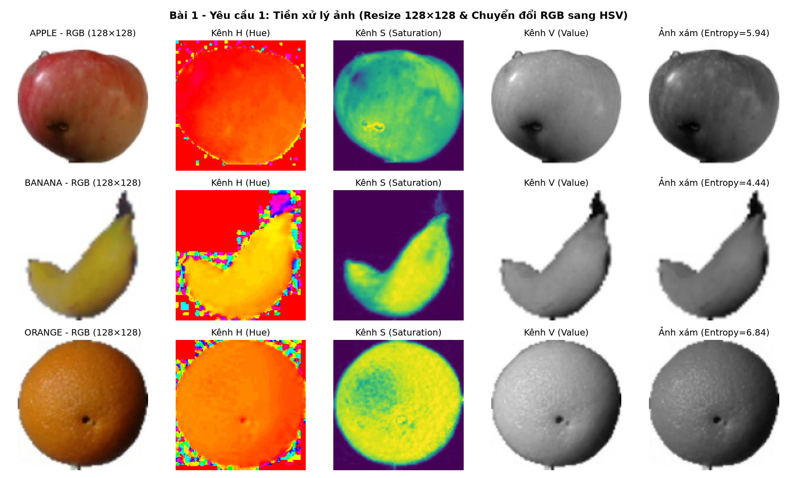

2. Trích chọn đặc trưng (yêu cầu 2 — vector 45 chiều cho mỗi ảnh):
   - Trung bình và độ lệch chuẩn trên không gian màu RGB: 6 chiều (gồm R_mean, G_mean, B_mean, R_std, G_std, B_std).
   - Trung bình và độ lệch chuẩn trên không gian màu HSV: 6 chiều (gồm H_mean, S_mean, V_mean, H_std, S_std, V_std).
   - Biểu đồ tần suất màu HSV chuẩn hóa L1: 32 chiều (kênh H chia 16 khoảng trong $[0, 180)$; kênh S chia 8 khoảng trong $[0, 256)$; kênh V chia 8 khoảng trong $[0, 256)$).
   - Độ hỗn loạn thông tin Shannon (entropy) của ảnh mức xám: 1 chiều ($H = -\sum p_i \log_2 p_i$).

| Nhãn lớp | Số mẫu | R_mean | G_mean | B_mean | R_std | H_mean | S_mean | V_mean | Gray_Entropy (bits) |
| :--- | :---: | :---: | :---: | :---: | :---: | :---: | :---: | :---: | :---: |
| apple (30 giống) | 600 | 171.93 | 140.48 | 126.74 | 69.85 | 38.45 | 98.12 | 181.64 | 6.21 |
| banana (6 giống) | 600 | 220.41 | 211.65 | 180.52 | 49.12 | 25.18 | 64.30 | 222.84 | 4.76 |
| orange (6 giống) | 600 | 216.85 | 152.34 | 96.40 | 53.60 | 16.42 | 156.78 | 217.10 | 6.38 |

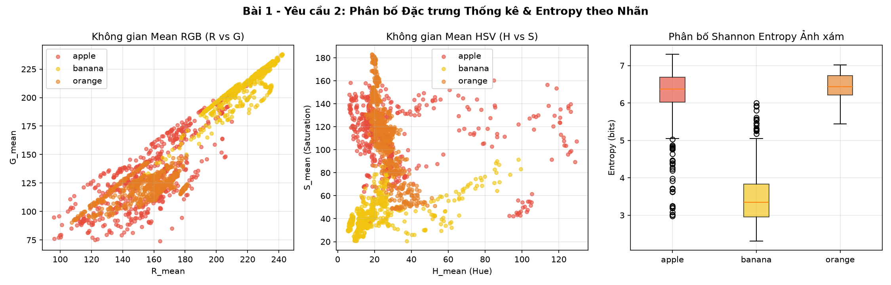

### 1.3. Kết quả đánh giá bốn thí nghiệm (TN1 – TN4)
Tập dữ liệu 1.800 ảnh được chia thành tập huấn luyện và tập kiểm thử theo tỷ lệ 80/20 có phân tầng (gồm 1.440 ảnh huấn luyện, 360 ảnh kiểm thử) và chuẩn hóa dựa trên tập huấn luyện:

| Thí nghiệm | Nhóm đặc trưng | Số chiều | Mô hình | Accuracy | Precision | Recall | F1-score |
| :--- | :--- | :---: | :---: | :---: | :---: | :---: | :---: |
| TN1 | Trung bình và độ lệch chuẩn RGB | 6 | KNN ($k=5$) | 0.9694 | 0.9720 | 0.9694 | 0.9694 |
| TN2 | Trung bình và độ lệch chuẩn HSV | 6 | KNN ($k=5$) | 0.9722 | 0.9733 | 0.9722 | 0.9721 |
| TN3 | Biểu đồ tần suất màu HSV | 32 | SVM (RBF) | 0.9917 | 0.9917 | 0.9917 | 0.9917 |
| TN4 | Kết hợp toàn bộ đặc trưng | 45 | SVM (RBF) | 0.9917 | 0.9917 | 0.9917 | 0.9917 |

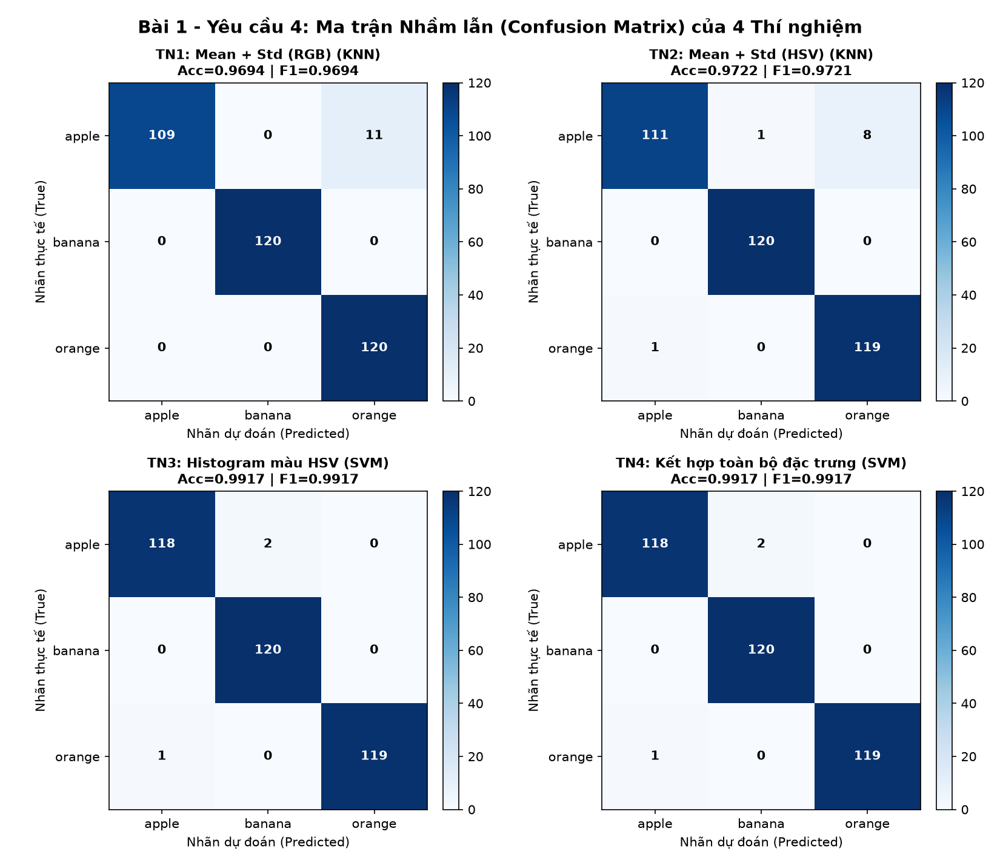

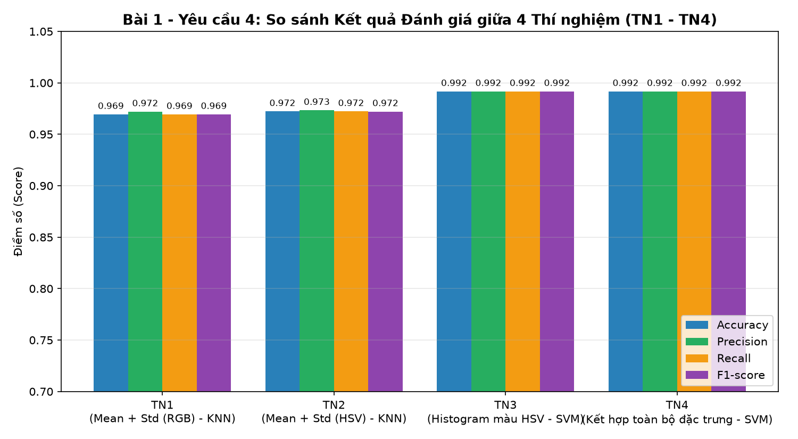

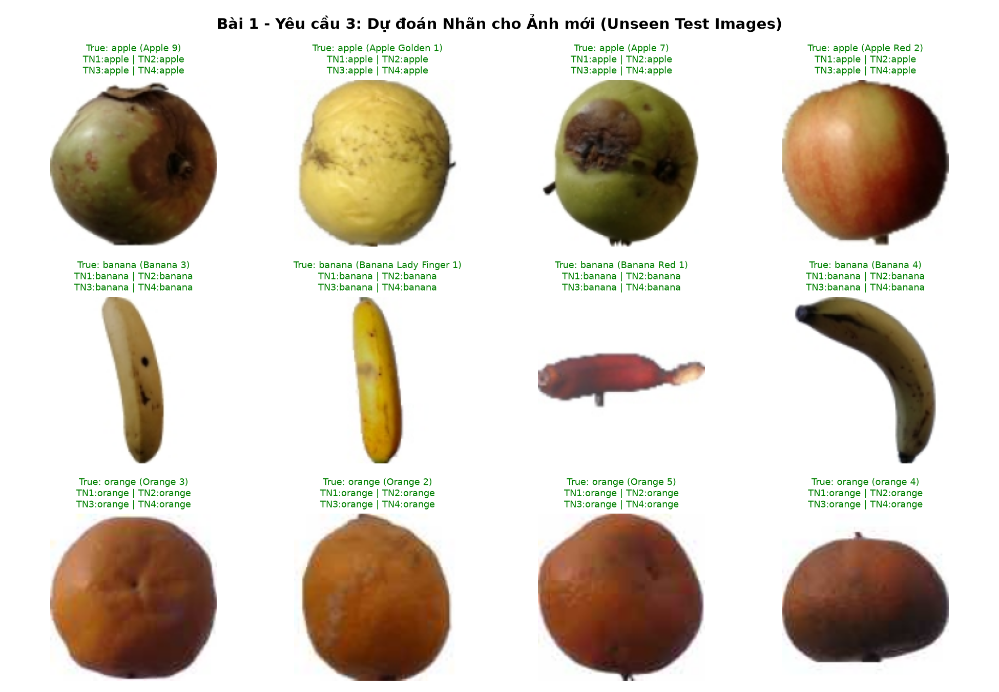

### 1.4. Trả lời câu hỏi thảo luận bài 1 (câu 5, 6, 7)

#### Câu 5. Vì sao cần trích chọn đặc trưng thay vì dùng trực tiếp toàn bộ điểm ảnh?
- Giảm số chiều dữ liệu và tránh lời nguyền số chiều: Một ảnh màu $128 \times 128 \times 3$ có tới $49.152$ chiều. Đưa trực tiếp $49.152$ chiều vào mô hình KNN hoặc SVM khiến khoảng cách Euclid bị dàn trải, dễ gây quá khớp và tốn chi phí tính toán lớn. Bước trích chọn đặc trưng giúp nén ảnh xuống chỉ còn từ $6$ đến $45$ chiều (giảm hơn $1.000$ lần số chiều), giúp mô hình học nhanh và tổng quát hóa tốt.
- Đảm bảo tính bất biến với phép dịch chuyển và góc quay: Nếu dùng trực tiếp tọa độ điểm ảnh $(x, y)$, chỉ cần quả dịch chuyển hoặc xoay nhẹ là giá trị điểm ảnh tại $(x, y)$ thay đổi hoàn toàn. Ngược lại, các đặc trưng thống kê như trung bình, độ lệch chuẩn, biểu đồ tần suất màu và entropy được tính tổng hợp trên toàn ảnh nên bất biến với vị trí và góc xoay của quả.
- Chắt lọc thông tin bản chất và loại bỏ nhiễu: Giúp mô hình tập trung vào sắc độ màu, độ bão hòa và độ phức tạp bề mặt thay vì ghi nhớ từng điểm ảnh nền dư thừa.

#### Câu 6. Không gian màu RGB và HSV ảnh hưởng thế nào đến kết quả phân loại?
- Trong không gian màu RGB, ba kênh $R, G, B$ bị trộn lẫn giữa thông tin màu sắc và cường độ chiếu sáng. Khi độ sáng thay đổi hoặc có bóng đổ trên mặt quả, cả ba kênh $R, G, B$ biến thiên cùng nhau, dẫn đến sự chồng lấn giữa một số giống táo vàng hoặc táo đỏ cam với quả cam (thí nghiệm 1 đạt độ chính xác 96.94%, nhầm 11 mẫu táo sang cam).
- Trong không gian màu HSV, tông màu thuần khiết ($H$) và độ bão hòa ($S$) được tách biệt rõ khỏi cường độ sáng ($V$). Nhờ đó kênh $H$ và $S$ ổn định trước sự thay đổi ánh sáng, giúp giảm số mẫu nhầm từ 11 xuống 8 mẫu ở thí nghiệm 2 (độ chính xác đạt 97.22%), và đạt tới 99.17% khi dùng biểu đồ tần suất màu HSV ở thí nghiệm 3.

#### Câu 7. Kết hợp nhiều đặc trưng có luôn làm tăng độ chính xác không?
- Việc kết hợp nhiều đặc trưng không phải lúc nào cũng làm tăng độ chính xác. Thực nghiệm cho thấy thí nghiệm 3 (32 chiều biểu đồ tần suất HSV) đã đạt 99.17%, và khi ghép thêm 13 chiều (gồm trung bình, độ lệch chuẩn RGB, HSV và entropy) ở thí nghiệm 4 (45 chiều), độ chính xác vẫn giữ nguyên ở mức 99.17%.
- Nguyên nhân gồm: thứ nhất là sự dư thừa thông tin vì kỳ vọng và phương sai của màu sắc đã nằm ẩn trong phân bố biểu đồ tần suất nên việc ghép thêm không tạo ra biên thông tin mới; thứ hai là nguy cơ pha loãng đặc trưng mạnh khi ghép thêm các đặc trưng nhiều chiều nhưng nhạy với nhiễu (như thấy rõ ở bài 2 khi ghép 1.764 chiều HOG với 7 chiều hình dạng), khiến các chiều nhiễu lấn át đặc trưng tốt nếu không chọn lọc hoặc đánh trọng số phù hợp.

---

## 2. Bài 2: Phân loại đối tượng dựa trên đặc trưng hình dạng và HOG

### 2.1. Mục tiêu và dữ liệu đầu vào
- Mục tiêu của bài thực hành là thực hiện phân ngưỡng Otsu, phát hiện biên Canny, xác định đường bao đối tượng; trích chọn các đặc trưng hình học ($A, P, W, H, AR, C, ED$) và vector HOG; từ đó so sánh hiệu năng của ba mô hình KNN, SVM và Random Forest.
- Dữ liệu đầu vào gồm bộ ảnh của ba lớp đối tượng hình học là hình tròn (circle), hình vuông (square) và hình tam giác (triangle) được khởi tạo tự động bằng thư viện OpenCV gồm 150 ảnh cho mỗi lớp (tổng cộng 450 ảnh kích thước $128 \times 128$, kèm 12 ảnh kiểm thử mới) với nền sáng hoặc tối ngẫu nhiên, thay đổi kích thước, vị trí tâm dịch chuyển ngẫu nhiên và góc quay từ $0^\circ$ đến $360^\circ$.

### 2.2. Tiền xử lý, phân đoạn và trích chọn đặc trưng hình dạng và HOG

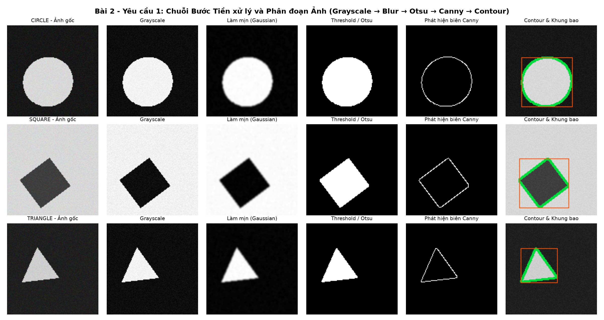

- Đặc trưng hình dạng (7 chiều): Diện tích $A$, chu vi $P$, chiều rộng và chiều cao khung bao $W, H$, tỷ lệ khung bao $AR = W/H$, độ tròn $C = \frac{4\pi A}{P^2}$ và mật độ điểm ảnh biên $ED$.
- Đặc trưng HOG (1.764 chiều): Chuẩn hóa ảnh về kích thước $64 \times 64$, kích thước ô lưới $8 \times 8$, kích thước khối $16 \times 16$, bước trượt khối $8 \times 8$, số khoảng chia góc bằng 9, thu được $7 \times 7 \times 4 \times 9 = 1.764$ chiều (lớn gấp 252 lần vector hình dạng 7 chiều).

| Lớp đối tượng | Diện tích ($A$) | Chu vi ($P$) | Chiều rộng ($W$) | Chiều cao ($H$) | Tỷ lệ ($AR$) | Độ tròn ($C$) | Mật độ biên ($ED$) |
| :--- | :---: | :---: | :---: | :---: | :---: | :---: | :---: |
| circle (150 ảnh) | 2777.96 | 196.46 | 59.35 | 59.42 | 1.002 | 0.892 | 0.049 |
| square (150 ảnh) | 3578.03 | 245.55 | 71.15 | 71.37 | 1.003 | 0.737 | 0.043 |
| triangle (150 ảnh) | 1190.47 | 162.13 | 51.63 | 51.55 | 1.012 | 0.556 | 0.056 |

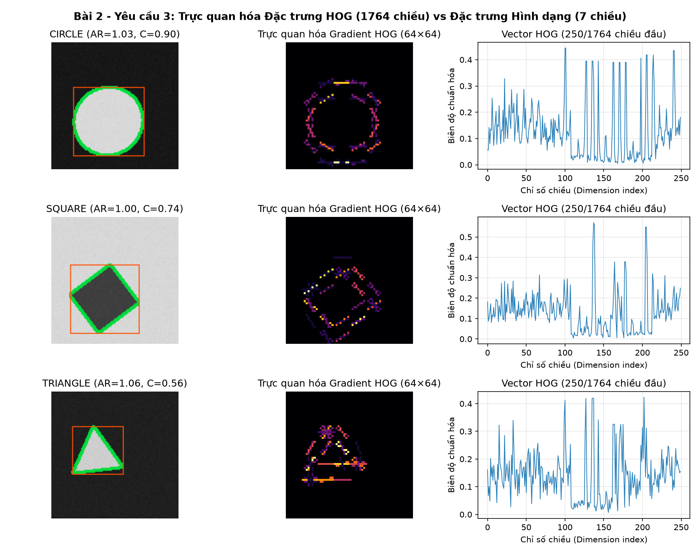

### 2.3. Kết quả phân loại và so sánh 9 tổ hợp (đặc trưng kết hợp với mô hình)

| Tập đặc trưng | Số chiều | Mô hình | Accuracy | Precision | Recall | F1-score |
| :--- | :---: | :---: | :---: | :---: | :---: | :---: |
| 1. Chỉ đặc trưng hình dạng | 7 | KNN ($k=5$) | 1.0000 | 1.0000 | 1.0000 | 1.0000 |
| 1. Chỉ đặc trưng hình dạng | 7 | SVM (RBF) | 1.0000 | 1.0000 | 1.0000 | 1.0000 |
| 1. Chỉ đặc trưng hình dạng | 7 | Random Forest | 1.0000 | 1.0000 | 1.0000 | 1.0000 |
| 2. Chỉ đặc trưng HOG | 1764 | KNN ($k=5$) | 0.9111 | 0.9244 | 0.9111 | 0.9101 |
| 2. Chỉ đặc trưng HOG | 1764 | SVM (RBF) | 0.9222 | 0.9250 | 0.9222 | 0.9221 |
| 2. Chỉ đặc trưng HOG | 1764 | Random Forest | 0.8222 | 0.8361 | 0.8222 | 0.8207 |
| 3. Kết hợp hình dạng và HOG | 1771 | KNN ($k=5$) | 0.9222 | 0.9369 | 0.9222 | 0.9211 |
| 3. Kết hợp hình dạng và HOG | 1771 | SVM (RBF) | 0.9222 | 0.9250 | 0.9222 | 0.9221 |
| 3. Kết hợp hình dạng và HOG | 1771 | Random Forest | 0.8667 | 0.8747 | 0.8667 | 0.8639 |

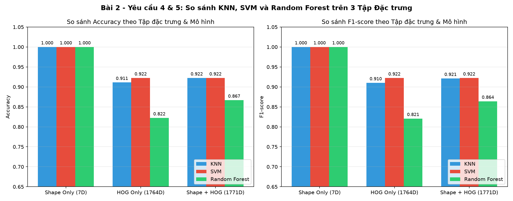

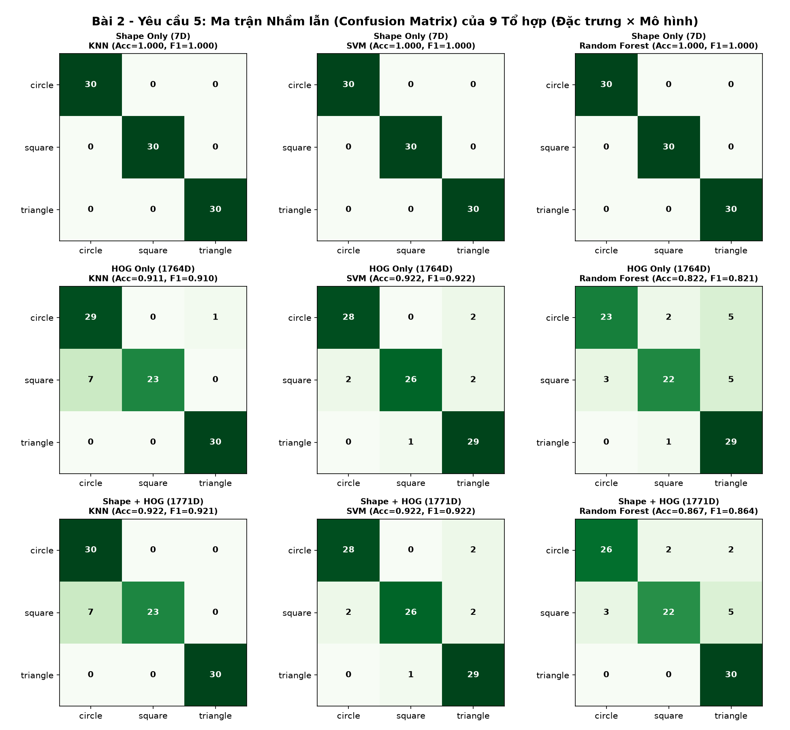

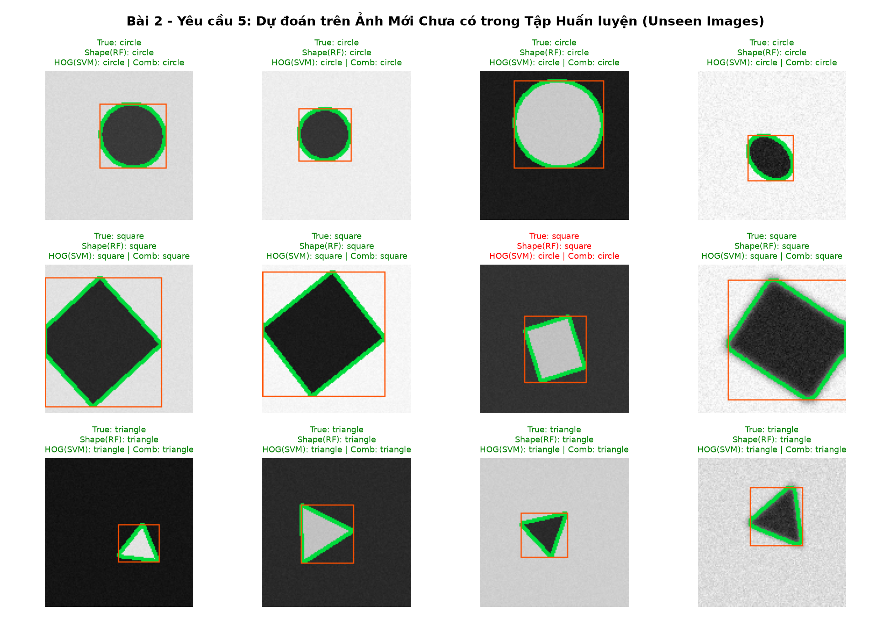

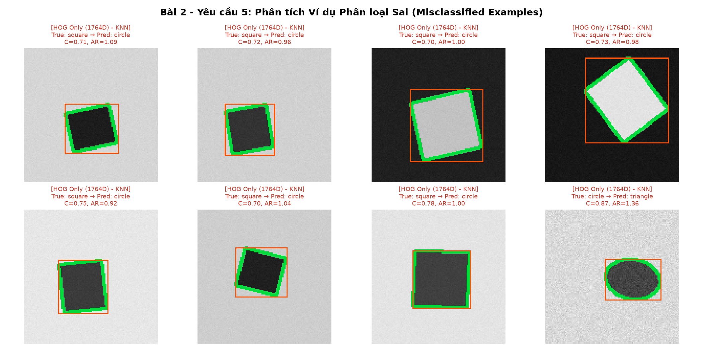

### 2.4. Trả lời câu hỏi thảo luận bài 2 (câu 12, 13, 14, 15)

#### Câu 12. Vì sao đặc trưng hình dạng phân biệt được hình tròn, hình vuông và hình tam giác?
- Ba hình học cơ bản có tỷ số đẳng chu giữa diện tích $A$ và bình phương chu vi $P^2$ hoàn toàn tách biệt nhau thông qua công thức độ tròn $C = \frac{4\pi A}{P^2}$:
  - Hình tròn không có góc nhọn, đạt diện tích cực đại cho một chu vi cố định với giá trị lý thuyết bằng $1.0$ và thực nghiệm trung bình đạt $0.892$.
  - Hình vuông có 4 góc vuông với giá trị lý thuyết bằng $\frac{\pi}{4} \approx 0.785$ và thực nghiệm trung bình đạt $0.737$.
  - Hình tam giác đều có 3 góc nhọn khiến chu vi kéo dài so với diện tích với giá trị lý thuyết bằng $\frac{\pi}{3\sqrt{3}} \approx 0.604$ và thực nghiệm trung bình đạt $0.556$.
- Khoảng cách giữa ba giá trị độ tròn này rất lớn và không bị chồng lấn, giúp các mô hình KNN, SVM và Random Forest đều đạt độ chính xác 100%.

#### Câu 13. Đặc trưng HOG mô tả thông tin gì?
- Đặc trưng HOG mô tả hình dáng cục bộ và cấu trúc đường biên của đối tượng thông qua việc thống kê phân bố tần suất của độ lớn và hướng đạo hàm mức xám trong từng ô lưới nhỏ kích thước $8 \times 8$ điểm ảnh, kết hợp chuẩn hóa độ tương phản trên từng vùng lân cận lớn hơn kích thước $16 \times 16$ điểm ảnh.

#### Câu 14. Việc thay đổi kích thước hoặc góc quay ảnh hưởng ra sao?
- Đối với đặc trưng hình dạng: Việc thay đổi kích thước làm thay đổi diện tích $A$, chu vi $P$, chiều rộng $W$ và chiều cao $H$, nhưng hai đặc trưng tỷ lệ là độ tròn ($C = 4\pi A/P^2$) và tỷ lệ khung bao ($AR = W/H$) hoàn toàn bất biến với kích thước. Khi thay đổi góc quay từ $0^\circ$ đến $360^\circ$, các chỉ số diện tích $A$, chu vi $P$ và độ tròn $C$ hoàn toàn bất biến với phép quay.
- Đối với đặc trưng HOG: Thuật toán HOG chia ảnh theo lưới tọa độ cố định và chia góc đạo hàm thành 9 khoảng cố định ($0^\circ \div 180^\circ$). Do đó, khi vật thể dịch chuyển vị trí, thay đổi kích thước hoặc xoay góc bất kỳ, các cạnh biên sẽ rơi vào các ô lưới khác nhau và đổi hướng sang các khoảng góc khác, làm vector HOG biến đổi mạnh (khiến độ chính xác của mô hình chỉ dùng HOG giảm xuống mức $82.22\% \div 92.22\%$).

#### Câu 15. Khi nào nên dùng đặc trưng hình dạng, khi nào nên dùng đặc trưng HOG?
- Nên dùng đặc trưng hình dạng khi đối tượng có độ tương phản tốt với nền, dễ dàng phân đoạn để tách được đường bao khép kín, đối tượng có thể xoay ở mọi góc độ từ $0^\circ$ đến $360^\circ$ và hệ thống yêu cầu tốc độ tính toán nhanh với số chiều nhỏ (7 chiều).
- Nên dùng đặc trưng HOG khi ảnh có nền phức tạp hoặc nhiều chi tiết bên trong đối tượng khiến việc phân ngưỡng tách đường bao thất bại, và đối tượng có hướng tương đối ổn định hoặc đã được cắt theo khung bao chuẩn hóa (như phát hiện người đi bộ, phương tiện giao thông, khuôn mặt hoặc ký tự chữ viết).

---

## 3. Cấu trúc thư mục và danh mục sản phẩm

- Tệp bai1_color_stats.py và Bai1_PhanLoai_MauSac_ThongKe.ipynb: Mã nguồn và sổ tay thực hành bài 1.
- Tệp bai2_shape_hog.py và Bai2_PhanLoai_HinhDang_HOG.ipynb: Mã nguồn và sổ tay thực hành bài 2.
- Thư mục outputs/bai1/ và outputs/bai2/: Toàn bộ bảng đặc trưng định dạng csv, bảng kết quả đánh giá và các hình ảnh minh họa định dạng png.
- Tệp Bao_cao_BTH06.pdf, 23020767_NguyenQuangTuan.pdf và Bao_cao_BTH06.tex: Báo cáo hoàn chỉnh định dạng PDF và LaTeX.
