# BÁO CÁO THỰC HÀNH SỐ 6: TRÍCH CHỌN ĐẶC TRƯNG ẢNH VÀ ỨNG DỤNG TRONG CÁC MÔ HÌNH HỌC MÁY (KNN, SVM, RANDOM FOREST)
Môn học: Xử lý ảnh và Thị giác Robot (RBE3015)  
Sinh viên thực hiện: Nguyễn Quang Tuân – 23020767  
Giảng viên phụ trách: PGS.TS. Hoàng Văn Xiêm | CN. Bùi Đình Đăng  

---

## MỤC LỤC
1. [Bài 1: Phân loại ảnh dựa trên đặc trưng thống kê và màu sắc](#1-bài-1-phân-loại-ảnh-dựa-trên-đặc-trưng-thống-kê-và-màu-sắc)
2. [Bài 2: Phân loại đối tượng dựa trên đặc trưng hình dạng và HOG](#2-bài-2-phân-loại-đối-tượng-dựa-trên-đặc-trưng-hình-dạng-và-hog)
3. [Cấu trúc thư mục và hướng dẫn chạy lại mã nguồn](#3-cấu-trúc-thư-mục-và-hướng-dẫn-chạy-lại-mã-nguồn)

---

## 1. BÀI 1: PHÂN LOẠI ẢNH DỰA TRÊN ĐẶC TRƯNG THỐNG KÊ VÀ MÀU SẮC

### 1.1. Mục tiêu và dữ liệu đầu vào
- **Mục tiêu:** Trích chọn các đặc trưng thống kê cơ bản từ ảnh số (Mean, Std trên RGB/HSV, Histogram màu HSV, Entropy ảnh xám), biểu diễn ảnh bằng vector đặc trưng, xây dựng và đánh giá mô hình KNN và SVM.
- **Dữ liệu đầu vào:** Bộ ảnh 3 nhóm đối tượng: Táo (`apple`), Chuối (`banana`) và Cam (`orange`) lấy từ bộ dữ liệu `Fruits-360` (`fruits-360-100x100`). Thực nghiệm lấy mẫu phân tầng cân bằng **600 ảnh/lớp** (tổng cộng **1.800 ảnh**, gấp 12 lần mức tối thiểu 50 ảnh/lớp của đề bài) trải đều trên toàn bộ 30 thư mục Táo (20 ảnh/thư mục), 6 thư mục Chuối (100 ảnh/thư mục) và 6 thư mục Cam (100 ảnh/thư mục), kèm 12 ảnh kiểm thử mới (`unseen`) tách riêng.

### 1.2. Tiền xử lý và trích chọn đặc trưng
1. **Tiền xử lý (Yêu cầu 1):** Đọc ảnh, chuyển từ BGR sang RGB, thay đổi kích thước về $128 \times 128$ pixel, chuyển đổi sang không gian màu HSV và ảnh mức xám.

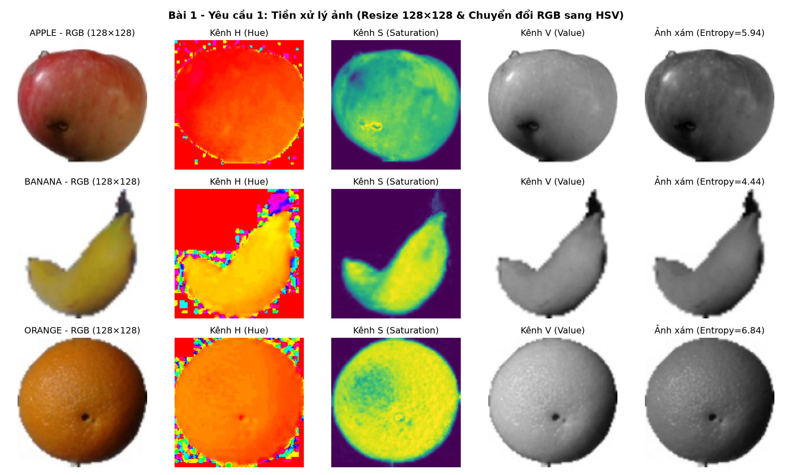

2. **Trích chọn đặc trưng (Yêu cầu 2 — Vector 45 chiều/ảnh):**
   - **Mean + Std (RGB):** 6 chiều (`R_mean, G_mean, B_mean, R_std, G_std, B_std`).
   - **Mean + Std (HSV):** 6 chiều (`H_mean, S_mean, V_mean, H_std, S_std, V_std`).
   - **Histogram màu HSV chuẩn hóa L1:** 32 chiều (kênh H: 16 bins trong $[0, 180)$; kênh S: 8 bins trong $[0, 256)$; kênh V: 8 bins trong $[0, 256)$).
   - **Entropy Shannon của ảnh xám:** 1 chiều ($H = -\sum p_i \log_2 p_i$).

| Nhãn | Số mẫu | R_mean | G_mean | B_mean | R_std | H_mean | S_mean | V_mean | Gray_Entropy (bits) |
| :--- | :---: | :---: | :---: | :---: | :---: | :---: | :---: | :---: | :---: |
| `apple` (30 giống) | 600 | 171.93 | 140.48 | 126.74 | 69.85 | 38.45 | 98.12 | 181.64 | 6.21 |
| `banana` (6 giống) | 600 | 220.41 | 211.65 | 180.52 | 49.12 | 25.18 | 64.30 | 222.84 | 4.76 |
| `orange` (6 giống) | 600 | 216.85 | 152.34 | 96.40 | 53.60 | 16.42 | 156.78 | 217.10 | 6.38 |

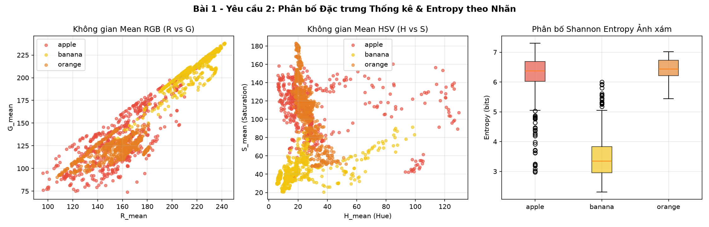

### 1.3. Kết quả đánh giá 4 thí nghiệm (TN1 – TN4)
Tập dữ liệu 1.800 ảnh được chia `Train/Test = 80/20` có phân tầng (1.440 ảnh Train, 360 ảnh Test) và chuẩn hóa `StandardScaler` dựa trên tập Train:

| Thí nghiệm | Đặc trưng | Số chiều | Mô hình | Accuracy | Precision | Recall | F1-score |
| :--- | :--- | :---: | :---: | :---: | :---: | :---: | :---: |
| **TN1** | Mean + Std (RGB) | 6 | KNN ($k=5$) | 0.9694 | 0.9720 | 0.9694 | 0.9694 |
| **TN2** | Mean + Std (HSV) | 6 | KNN ($k=5$) | 0.9722 | 0.9733 | 0.9722 | 0.9721 |
| **TN3** | Histogram màu HSV | 32 | SVM (RBF) | **0.9917** | **0.9917** | **0.9917** | **0.9917** |
| **TN4** | Kết hợp toàn bộ đặc trưng | 45 | SVM (RBF) | **0.9917** | **0.9917** | **0.9917** | **0.9917** |

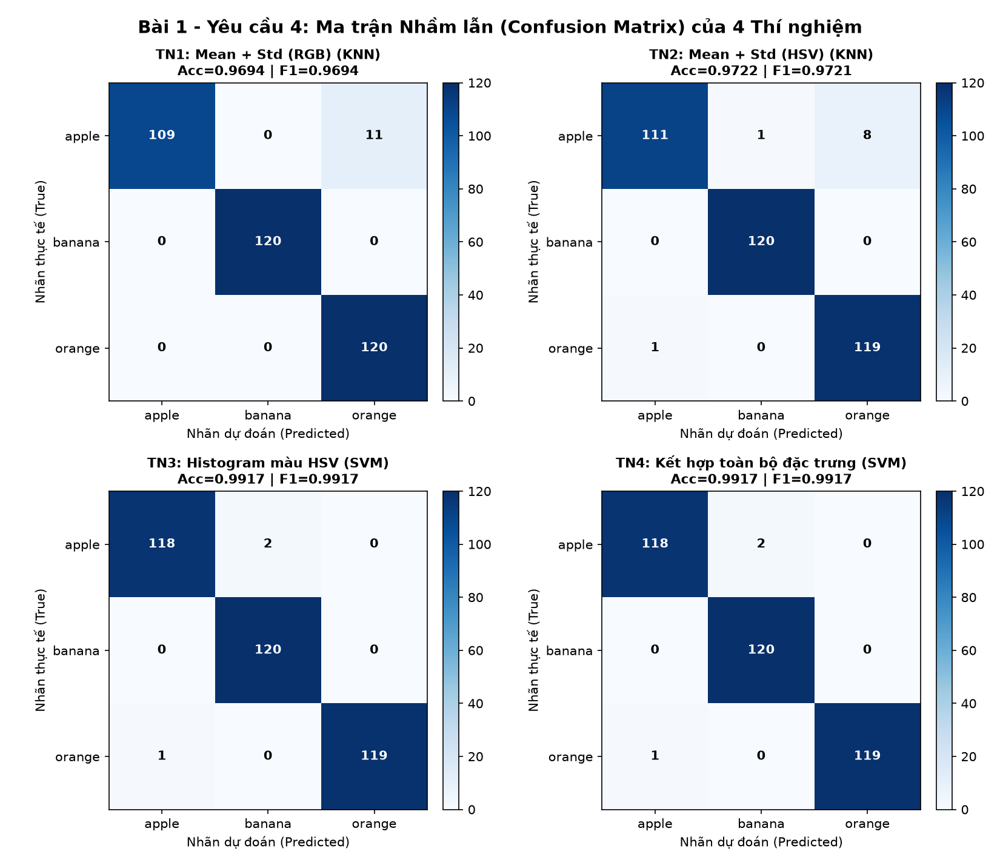

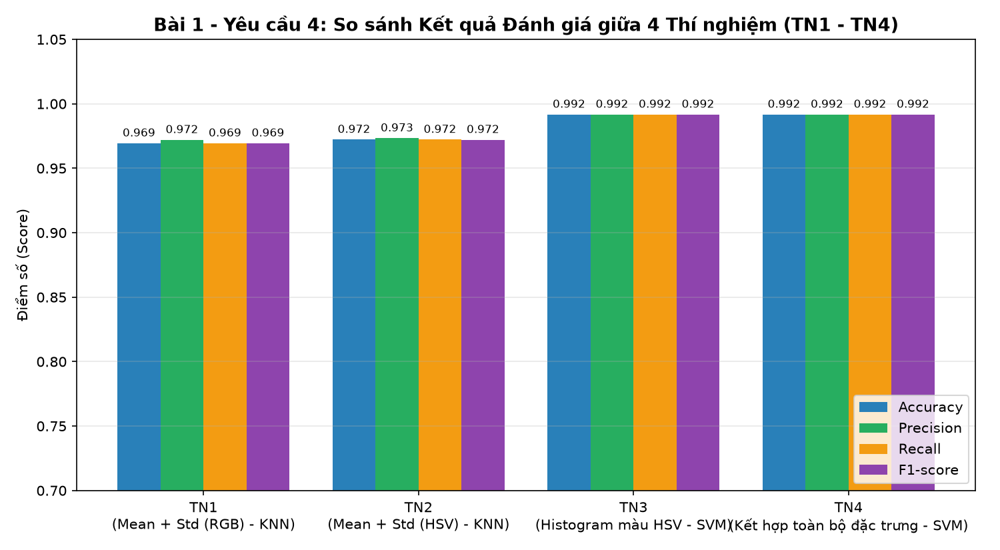

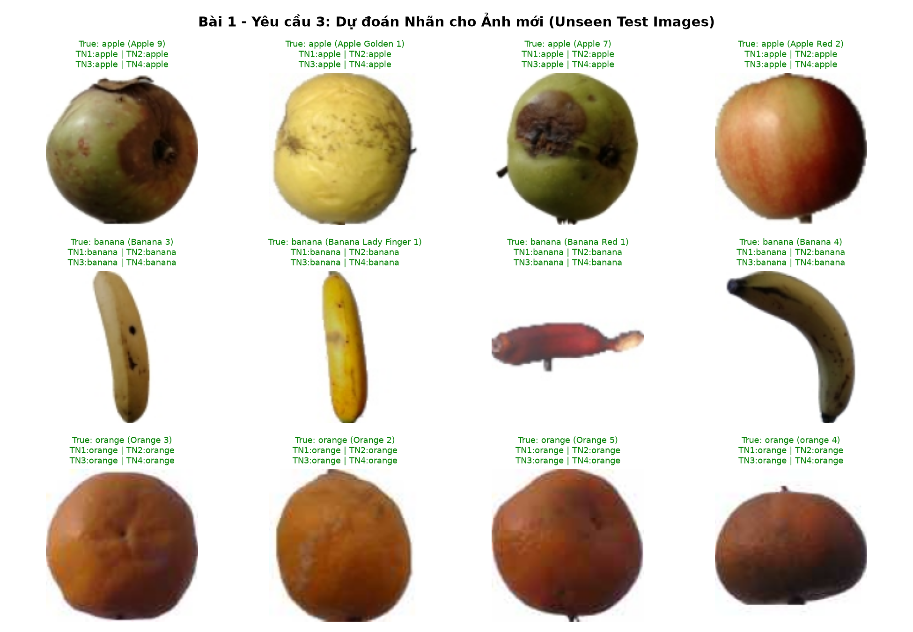

### 1.4. Trả lời câu hỏi thảo luận Bài 1 (Câu 5, 6, 7)

#### Câu 5. Vì sao cần trích chọn đặc trưng thay vì dùng trực tiếp toàn bộ pixel?
- **Giảm số chiều và tránh "Lời nguyền số chiều" (Curse of Dimensionality):** Một ảnh màu $128 \times 128 \times 3$ có tới $49.152$ chiều. Đưa trực tiếp $49.152$ chiều vào KNN hoặc SVM khiến khoảng cách Euclid bị dàn trải, dễ quá khớp (overfitting) và tốn chi phí tính toán lớn. Trích chọn đặc trưng nén ảnh xuống còn $6 \div 45$ chiều (giảm hơn $1.000$ lần số chiều), giúp mô hình học nhanh và tổng quát hóa tốt.
- **Bất biến với dịch chuyển và góc quay:** Nếu dùng trực tiếp tọa độ pixel $(x, y)$, chỉ cần quả dịch chuyển hoặc xoay nhẹ là giá trị pixel tại $(x, y)$ thay đổi hoàn toàn. Ngược lại, các đặc trưng thống kê (Mean, Std, Histogram, Entropy) tổng hợp trên toàn ảnh nên bất biến với vị trí và góc xoay của quả.
- **Chắt lọc thông tin bản chất, loại bỏ nhiễu:** Giúp mô hình tập trung vào sắc độ màu, độ bão hòa và độ phức tạp bề mặt thay vì ghi nhớ từng điểm ảnh nền dư thừa.

#### Câu 6. RGB và HSV ảnh hưởng thế nào đến kết quả phân loại?
- **RGB:** Ba kênh $R, G, B$ bị trộn lẫn giữa thông tin màu sắc (chrominance) và cường độ sáng (luminance). Khi độ sáng thay đổi hoặc có bóng đổ trên mặt quả, cả 3 kênh $R, G, B$ biến thiên cùng nhau, dẫn đến sự chồng lấn giữa một số giống táo vàng/đỏ cam với quả cam (TN1 đạt Accuracy = 96.94%, nhầm 11 mẫu táo sang cam).
- **HSV:** Tách biệt rõ **tông màu thuần khiết ($H$ - Hue)** và **độ bão hòa ($S$ - Saturation)** khỏi **cường độ sáng ($V$ - Value)**. Nhờ đó kênh $H$ và $S$ ổn định trước sự thay đổi ánh sáng, giúp giảm số ca nhầm từ 11 xuống 8 mẫu ở TN2 (Accuracy = 97.22%), và đạt tới **99.17%** khi dùng Histogram màu HSV ở TN3.

#### Câu 7. Kết hợp nhiều đặc trưng có luôn tăng độ chính xác không?
- **Không phải lúc nào kết hợp nhiều đặc trưng cũng làm tăng độ chính xác.** Thực nghiệm cho thấy TN3 (32 chiều Histogram HSV) đã đạt **99.17%**, và khi ghép thêm 13 chiều (Mean+Std RGB/HSV + Entropy) ở TN4 (45 chiều), độ chính xác vẫn giữ nguyên ở **99.17%**.
- **Nguyên nhân:** (1) *Sự dư thừa thông tin (Redundancy):* Kỳ vọng và phương sai của màu sắc đã nằm ẩn trong phân bố Histogram nên việc ghép thêm không tạo ra biên thông tin mới; (2) *Nguy cơ pha loãng đặc trưng mạnh:* Nếu ghép thêm các đặc trưng nhiều chiều nhưng nhạy với nhiễu (như thấy rõ ở Bài 2 khi ghép HOG 1764D với Shape 7D), các chiều nhiễu có thể lấn át đặc trưng tốt nếu không chọn lọc hoặc đánh trọng số phù hợp.

---

## 2. BÀI 2: PHÂN LOẠI ĐỐI TƯỢNG DỰA TRÊN ĐẶC TRƯNG HÌNH DẠNG VÀ HOG

### 2.1. Mục tiêu và dữ liệu đầu vào
- **Mục tiêu:** Thực hành phân ngưỡng Otsu, phát hiện biên Canny, xác định Contour; trích chọn 6 nhóm đặc trưng hình học ($A, P, W, H, AR, C, ED$) và vector HOG; so sánh KNN, SVM và Random Forest.
- **Dữ liệu đầu vào:** Bộ ảnh 3 lớp đối tượng (`circle`, `square`, `triangle`) được khởi tạo tự động bằng OpenCV gồm **150 ảnh/lớp** (tổng cộng **450 ảnh** $128 \times 128$, kèm 12 ảnh `unseen`) với nền sáng/tối ngẫu nhiên, thay đổi kích thước, vị trí tâm dịch chuyển ngẫu nhiên và góc quay $0^\circ \div 360^\circ$.

### 2.2. Tiền xử lý, phân đoạn và trích chọn đặc trưng Hình dạng & HOG

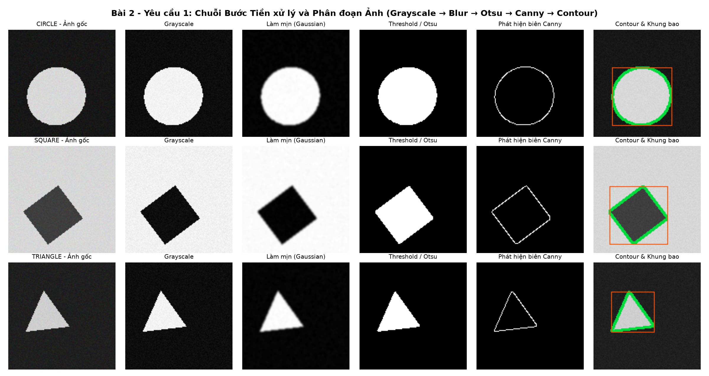

- **Đặc trưng hình dạng (7 chiều):** Diện tích $A$, Chu vi $P$, Kích thước $W, H$, Tỷ lệ khung bao $AR = W/H$, Độ tròn $C = \frac{4\pi A}{P^2}$, Mật độ biên $ED = \frac{\text{số pixel biên}}{\text{số pixel vùng xét}}$.
- **Đặc trưng HOG (1.764 chiều):** Chuẩn hóa ảnh về $64 \times 64$, `cell_size = (8,8)`, `block_size = (16,16)`, `block_stride = (8,8)`, `nbins = 9` $\Rightarrow 7 \times 7 \times 4 \times 9 = 1.764$ chiều (lớn gấp **252 lần** vector hình dạng 7 chiều).

| Lớp đối tượng | Area ($A$) | Perimeter ($P$) | Width ($W$) | Height ($H$) | AR ($W/H$) | Độ tròn ($C$) | Mật độ biên ($ED$) |
| :--- | :---: | :---: | :---: | :---: | :---: | :---: | :---: |
| `circle` (150 ảnh) | 2777.96 | 196.46 | 59.35 | 59.42 | 1.002 | **0.892** | 0.049 |
| `square` (150 ảnh) | 3578.03 | 245.55 | 71.15 | 71.37 | 1.003 | **0.737** | 0.043 |
| `triangle` (150 ảnh) | 1190.47 | 162.13 | 51.63 | 51.55 | 1.012 | **0.556** | 0.056 |

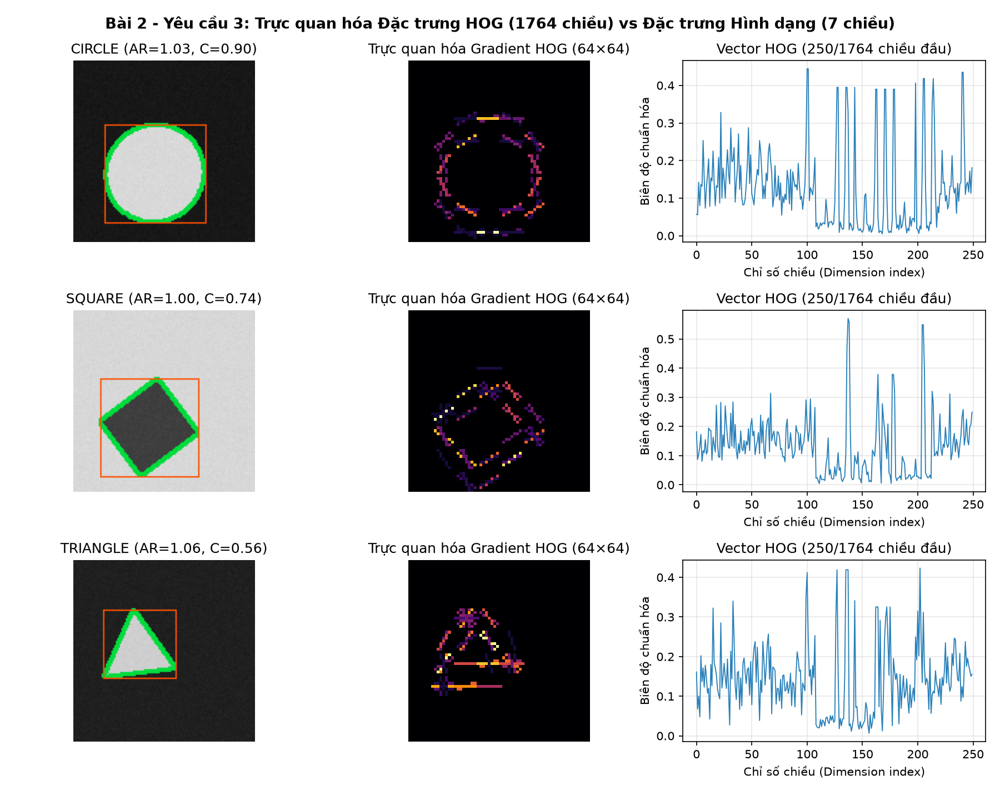

### 2.3. Kết quả phân loại và so sánh 9 tổ hợp (Đặc trưng × Mô hình)

| Tập đặc trưng | Số chiều | Mô hình | Accuracy | Precision | Recall | F1-score |
| :--- | :---: | :---: | :---: | :---: | :---: | :---: |
| **1. Shape Only (7D)** | 7 | KNN ($k=5$) | **1.0000** | **1.0000** | **1.0000** | **1.0000** |
| **1. Shape Only (7D)** | 7 | SVM (RBF) | **1.0000** | **1.0000** | **1.0000** | **1.0000** |
| **1. Shape Only (7D)** | 7 | Random Forest | **1.0000** | **1.0000** | **1.0000** | **1.0000** |
| **2. HOG Only (1764D)** | 1764 | KNN ($k=5$) | 0.9111 | 0.9244 | 0.9111 | 0.9101 |
| **2. HOG Only (1764D)** | 1764 | SVM (RBF) | **0.9222** | **0.9250** | **0.9222** | **0.9221** |
| **2. HOG Only (1764D)** | 1764 | Random Forest | 0.8222 | 0.8361 | 0.8222 | 0.8207 |
| **3. Shape + HOG (1771D)** | 1771 | KNN ($k=5$) | **0.9222** | **0.9369** | **0.9222** | **0.9211** |
| **3. Shape + HOG (1771D)** | 1771 | SVM (RBF) | **0.9222** | **0.9250** | **0.9222** | **0.9221** |
| **3. Shape + HOG (1771D)** | 1771 | Random Forest | 0.8667 | 0.8747 | 0.8667 | 0.8639 |

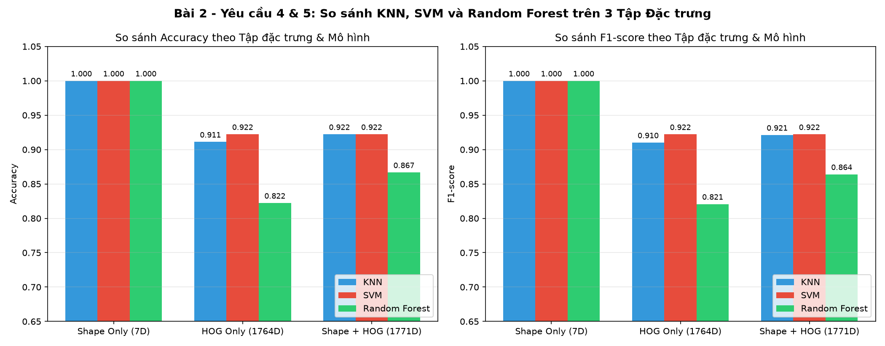

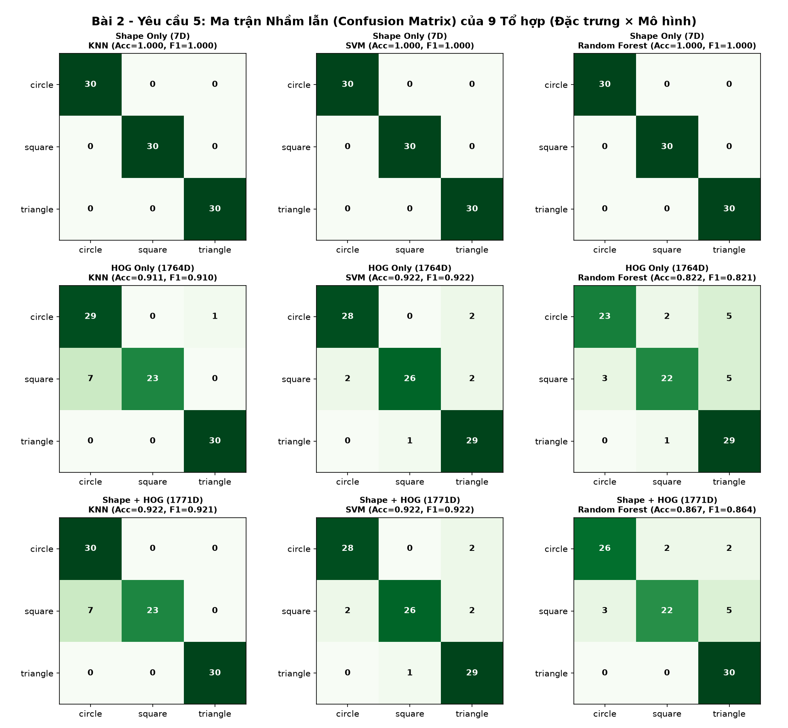

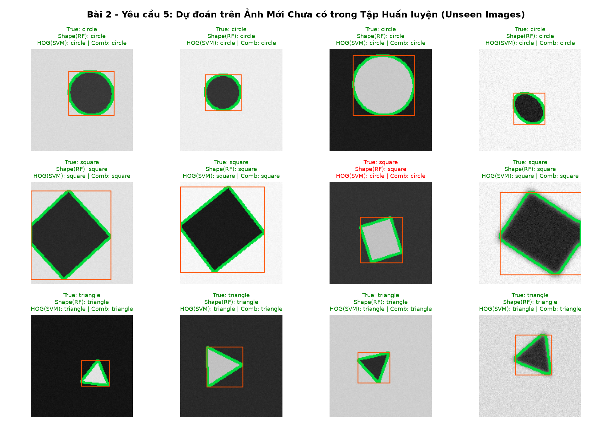

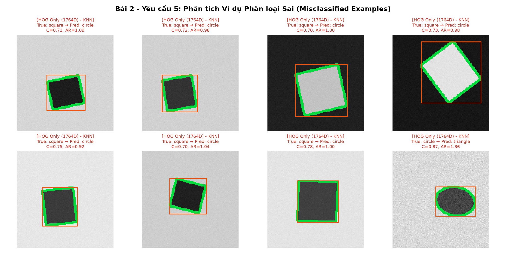

### 2.4. Trả lời câu hỏi thảo luận Bài 2 (Câu 12, 13, 14, 15)

#### Câu 12. Vì sao đặc trưng hình dạng phân biệt được tròn, vuông và tam giác?
- Ba hình học cơ bản có tỷ số đẳng chu giữa diện tích $A$ và bình phương chu vi $P^2$ hoàn toàn tách biệt nhau thông qua công thức **Độ tròn (Circularity)** $C = \frac{4\pi A}{P^2}$:
  - Hình tròn không có góc nhọn, đạt diện tích cực đại cho một chu vi cố định: $C_{\text{lý thuyết}} = 1.0$ (thực nghiệm trung bình $0.892$).
  - Hình vuông có 4 góc vuông: $C_{\text{lý thuyết}} = \frac{\pi}{4} \approx 0.785$ (thực nghiệm trung bình $0.737$).
  - Hình tam giác đều có 3 góc nhọn, chu vi kéo dài so với diện tích: $C_{\text{lý thuyết}} = \frac{\pi}{3\sqrt{3}} \approx 0.604$ (thực nghiệm trung bình $0.556$).
- Khoảng cách giữa 3 giá trị $C$ này rất lớn và không bị chồng lấn, giúp KNN, SVM và Random Forest đều đạt độ chính xác 100%.

#### Câu 13. HOG mô tả thông tin gì?
- **HOG (Histogram of Oriented Gradients)** mô tả **hình dáng cục bộ và cấu trúc đường biên** của đối tượng thông qua việc thống kê phân bố (histogram) của **độ lớn và hướng đạo hàm mức xám (gradient orientation)** trong từng ô lưới nhỏ (`cells` $8 \times 8$ px), kết hợp chuẩn hóa độ tương phản trên từng vùng lân cận lớn hơn (`blocks` $16 \times 16$ px).

#### Câu 14. Thay đổi kích thước hoặc góc quay ảnh hưởng ra sao?
- **Với đặc trưng hình dạng:** Thay đổi kích thước làm thay đổi $A, P, W, H$ nhưng hai đặc trưng tỷ lệ là **Độ tròn ($C = 4\pi A/P^2$)** và **Tỷ lệ khung bao ($AR = W/H$)** hoàn toàn **bất biến với kích thước**. Khi thay đổi góc quay $0^\circ \div 360^\circ$, các chỉ số $A, P$ và $C$ hoàn toàn **bất biến với phép quay**.
- **Với đặc trưng HOG:** HOG chia ảnh theo lưới tọa độ cố định và chia góc gradient thành 9 bin cố định ($0^\circ \div 180^\circ$). Do đó, khi vật thể dịch chuyển vị trí, thay đổi kích thước hoặc xoay góc bất kỳ, các cạnh biên sẽ rơi vào các ô lưới khác nhau và đổi hướng sang các bin góc khác, làm vector HOG biến đổi mạnh (khiến độ chính xác của HOG đơn lẻ giảm xuống $82.22\% \div 92.22\%$).

#### Câu 15. Khi nào nên dùng hình dạng, khi nào nên dùng HOG?
- **Nên dùng đặc trưng hình dạng khi:** Đối tượng có độ tương phản tốt với nền, dễ dàng phân đoạn (threshold/Otsu) để tách được đường bao Contour khép kín, đối tượng có thể xoay ở mọi góc độ $0^\circ \div 360^\circ$ và hệ thống yêu cầu tốc độ tính toán cực nhanh với số chiều nhỏ (7 chiều).
- **Nên dùng đặc trưng HOG khi:** Ảnh có nền phức tạp hoặc nhiều chi tiết bên trong đối tượng khiến việc phân ngưỡng tách Contour thất bại, và đối tượng có hướng tương đối ổn định hoặc đã được cắt khung bao ROI chuẩn hóa (như phát hiện người đi bộ, phương tiện giao thông, khuôn mặt, ký tự).

---

## 3. CẤU TRÚC THƯ MỤC VÀ HƯỚNG DẪN CHẠY LẠI MÃ NGUỒN

- `bai1_color_stats.py` & `Bai1_PhanLoai_MauSac_ThongKe.ipynb`: Mã nguồn và Notebook Bài 1.
- `bai2_shape_hog.py` & `Bai2_PhanLoai_HinhDang_HOG.ipynb`: Mã nguồn và Notebook Bài 2.
- `outputs/bai1/` & `outputs/bai2/`: Toàn bộ bảng đặc trưng `.csv`, bảng kết quả đánh giá `.csv` và các hình ảnh minh họa `.png`.
- `Bao_cao_BTH06.pdf` / `23020767_NguyenQuangTuan.pdf` & `Bao_cao_BTH06.tex`: Báo cáo hoàn chỉnh định dạng PDF và LaTeX.
